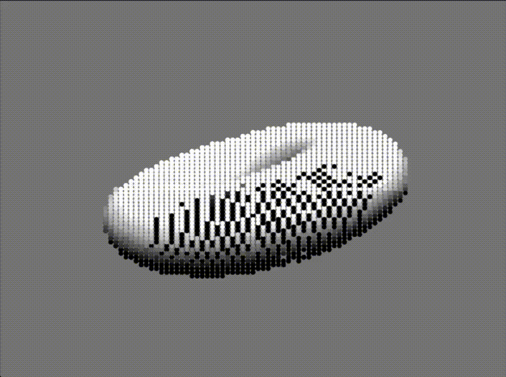

Spinning Torus Renderer

**A spinning 3D torus, rendered in Python — two different ways.**

## Demonstrations

<table>
  <tr>
    <th align="center">Matplotlib Renderer</th>
    <th align="center">Terminal Renderer</th>
  </tr>
  <tr>
    <td align="center">
      
    </td>
    <td align="center">
      
    </td>
  </tr>
  <tr>
    <td align="center">A point-based 3D animation with perspective projection and lighting.</td>
    <td align="center">A terminal animation using character brightness to represent the surface.</td>
  </tr>
</table>

## Concepts Explored

- **Parametric geometry** — generating a torus using two angular parameters.
- **3D rotations** — transforming coordinates to animate the surface.
- **Perspective projection** — mapping 3D points onto a 2D screen.
- **Z-buffering** — determining which surface points are visible.
- **Diffuse lighting** — calculating brightness from surface normals and a light direction.
- **ASCII rendering** — mapping brightness values to characters to create a terminal image.

## Implementations

| File | Description |
|---|---|
| `matplotlibdonut.py` | Animated torus using Matplotlib |
| `terminaldonut.py` | Character-based terminal renderer |

## Running the Project

Install the dependencies:

```bash
python -m pip install numpy matplotlib
```

Run either implementation:

```bash
python matplotlib_donut.py
```

```bash
python terminal_donut.py
```

**Inspiration** :[Donut math: how donut.c works](https://www.a1k0n.net/2011/07/20/donut-math.html).
